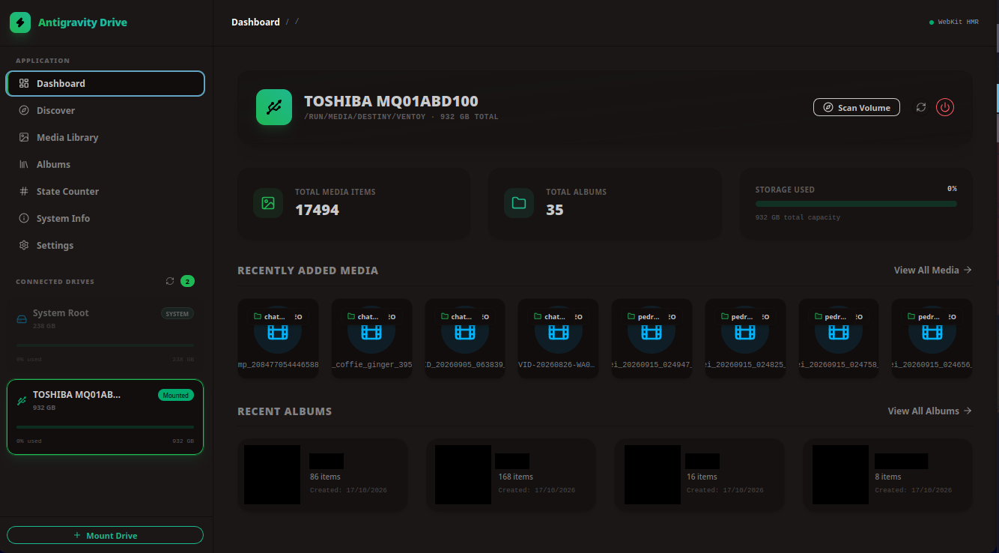
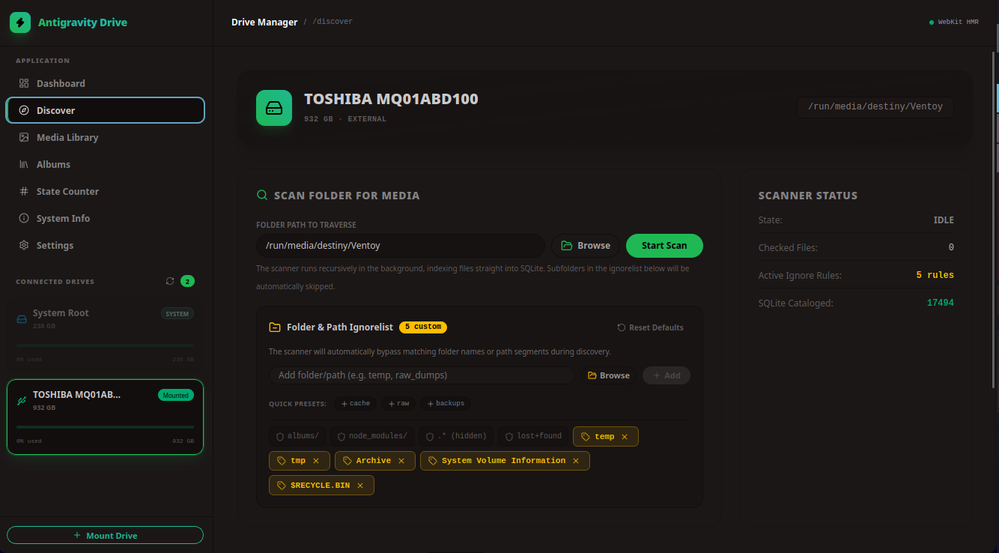
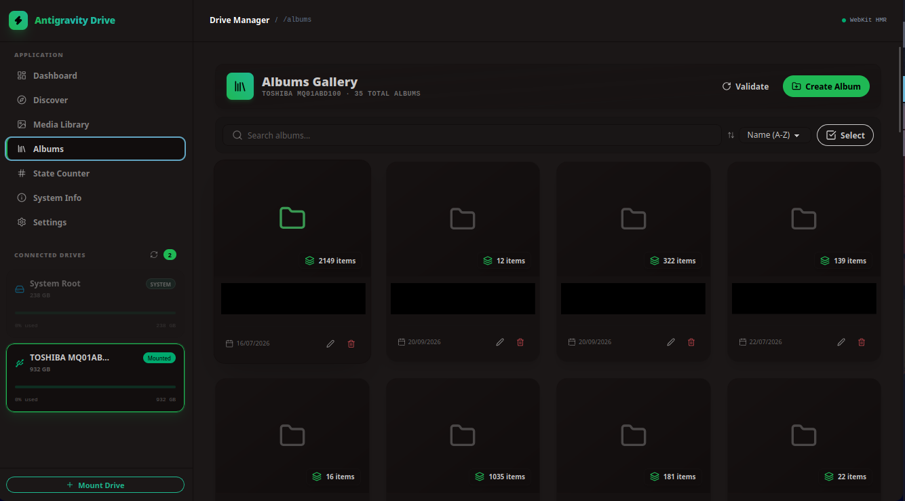
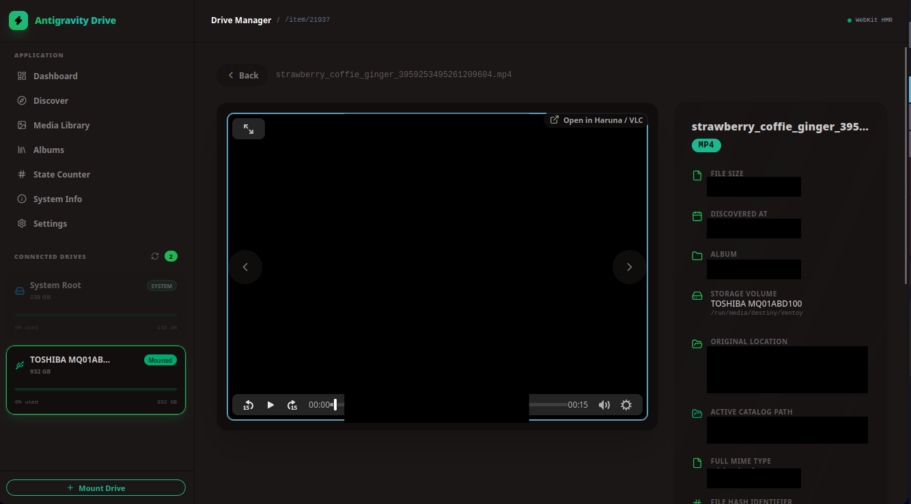
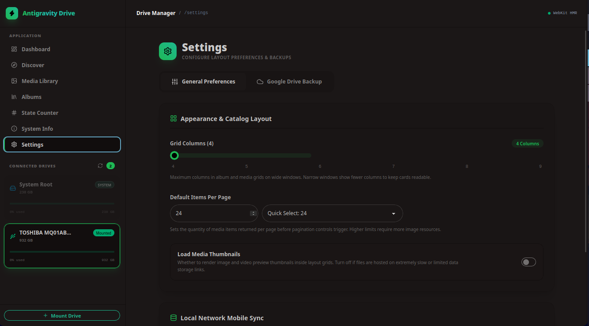
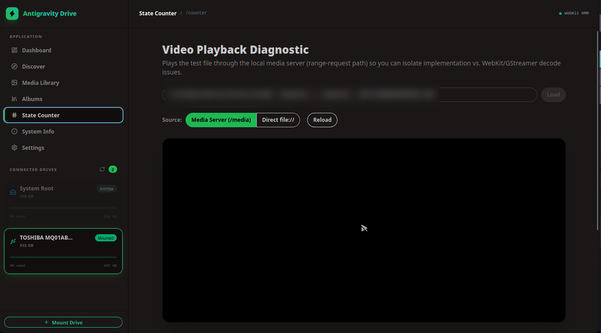

# D-Stream Desktop

D-Stream Desktop is a Solid and Electrobun media library for removable drives.

## Screenshots



| Discover | Media Library |
| --- | --- |
|  |  |
| Albums | Media player |
|  |  |
| Settings | System info |
|  |  |
| Playback diagnostic | |
|  | |

## Run locally

```bash
bun install
bun run dev
```

For frontend hot reload, use `bun run dev:hmr`.

## Build a release

```bash
bun run build:stable
```

The installer to share is printed at the end of the build and copied to
`release/stable/`. For a canary build, run `bun run build:canary` and find its
installer in `release/canary/`.

Pushes to `main` build Linux and macOS stable installers and attach them to a
GitHub Release. The update files in `artifacts/` stay out of the release assets.

On Linux, the release file is a `.tar.gz` archive. Extract it and run the
`installer` inside. On Windows, extract the release `.zip` and run the setup
program. On macOS, open the release `.dmg`.

For local Linux builds, `bun run build:stable` also refreshes the matching
`release/stable/*-Setup/` folder. Run its `installer` only after that build
finishes; the release script checks that the installer and update archive have
the same app identifier and build hash.

| Directory | Purpose |
| --- | --- |
| `release/<channel>/` | Clearly named installer to distribute |
| `artifacts/` | Electrobun's installer, update archive (`.tar.zst`), and update metadata |
| `build/` | Expanded app and temporary packaging files |
| `dist/` | Bundled frontend from Vite |

Electrobun's update archive in `artifacts/` is for the updater; the `-Setup`
archive is the Linux installer. The repeated app folder and archive names in
`build/` are packaging inputs, not additional releases.

The installed app lives under `~/.local/share/io.github.heisdezz.dstream/` on
Linux. Its `stable/app/` bundle contains the runtime, and `stable/self-extraction/`
holds an archive Electrobun uses for updates. Earlier builds installed under
`~/.local/share/reacttailwindvite.electrobun.dev/`; that installation remains
separate because Electrobun uses the app identifier as the installation key.
If you still have that older installation, remove it and its desktop shortcut
after confirming the current app works. New releases update the installation
under `io.github.heisdezz.dstream`.
